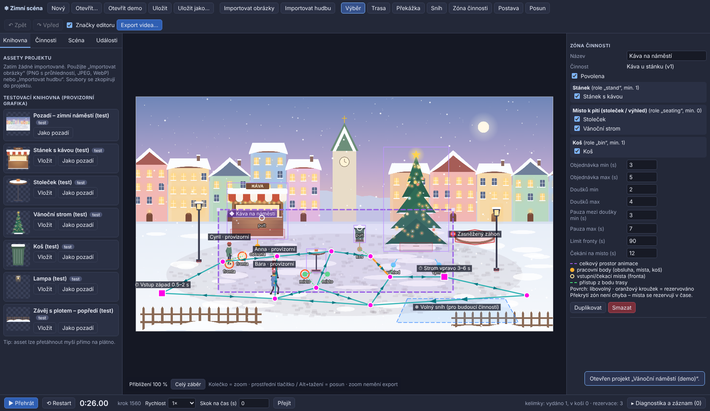

# Zimní scéna

Desktopový editor a exportér animovaných 2D zimních scén. Uživatel nahraje malované pozadí, rozmístí
objekty a postavy, nakreslí pochozí trasy, přiřadí připravené činnosti (zatím „káva u stánku“) a scénu
vyexportuje jako dlouhé MP4 video (až 3840 × 2160 při 30 fps) s vlastní hudbou.

Scéna se **skutečně simuluje** (pevný krok 1/60 s, deterministicky podle seedu) – export není záznam
obrazovky ani generované video. Editor, náhled i export používají stejný model scény, stejnou simulaci
a stejný renderer.

> Demo **„Náměstí s radnicí“** používá dodanou malovanou grafiku (pozadí, 4 stánky, strom, lampy) –
> viz [docs/GRAFIKA.md](docs/GRAFIKA.md) a ukázka `ukazky/namesti-radnice-20s-1080p.mp4`.
> Postavy, stoleček a koš jsou zatím **provizorní** testovací.



## Webová verze (bez instalace)

Aplikace běží i v prohlížeči z odkazu **https://matousssssCZ.github.io/zivapozadi/** (Chrome / Edge).
Po otevření se rovnou načte scéna „Liberec – živý trh“; úpravy se po **Uložit** ukládají v prohlížeči
a při dalším otevření odkazu zůstanou. Export videa (MP4, bez zvuku) se stáhne jako soubor.
Webová verze se sestaví a zveřejní automaticky při každém pushi do `main`
(`.github/workflows/pages.yml`; jednorázově je potřeba v GitHubu zapnout Settings → Pages →
Source: „GitHub Actions“). Lokálně: `npm run build:web` → složka `dist-web/`.

## Spuštění (vývoj)

Požadavky: Node.js 22+, npm. FFmpeg se instaluje automaticky balíčkem `ffmpeg-static`.

```bash
npm install
```

```bash
npm start
```

`npm start` sestaví hlavní proces i UI a spustí Electron. Pro vývoj s automatickým načítáním UI:

```bash
npm run dev
```

V aplikaci klikněte na **Otevřít „Liberec – živý trh“** (hlavní scéna), **Demo „Náměstí s radnicí“** (nebo „Vánoční náměstí“ s testovací grafikou) – demo se zkopíruje do
`Dokumenty/Zimní scéna/` a otevře. Pak stačí **▶ Přehrát** nebo **Export videa…**.

Projekt lze otevřít i při spuštění: proměnná `ZIMNI_SCENA_OPEN=/cesta/k/projektu.zscena`.

## Sestavení instalačních balíčků

Balíček se sestavuje na cílovém systému (FFmpeg je nativní binárka pro platformu sestavení):

```bash
npm run dist:win
```

```bash
npm run dist:mac
```

Výstup je ve složce `release/` (Windows: NSIS instalátor, macOS: DMG). Podepisování/notarizace
pro macOS není nastaveno. Na Linuxu lze ověřit zabalení příkazem `npx electron-builder --linux dir`.

## Testy a ověření

```bash
npm test
```

Jednotkové a integrační testy (Vitest): determinismus, checkpointy, rezervace, kelímek, ukládání,
přenos projektu, export MP4, navázání exportu, zvuk, značky v exportu.

```bash
npm run test:e2e
```

Test skutečné aplikace (Electron + Playwright): editace myší, zpět/vpřed, uložení/otevření, náhled 8×,
4K export z GUI, zrušení a navázání exportu, paměť. Na Linuxu bez displeje: `xvfb-run -a npm run test:e2e`.

Bezhlavý export (stejné jádro, renderer Skia přes `@napi-rs/canvas`):

```bash
npm run export:cli -- demo/Vanocni-namesti.zscena --out video.mp4 --res 3840x2160 --duration 10
```

## Dokumentace

* [docs/NAVRH.md](docs/NAVRH.md) – rozhodnutí před implementací (stack, vrstvy, balení, omezení)
* [docs/ARCHITEKTURA.md](docs/ARCHITEKTURA.md) – architektura
* [docs/FORMAT_ASSETU.md](docs/FORMAT_ASSETU.md) – formát projektu, assetů a manifestu postavy
* [docs/PRIDANI_CINNOSTI.md](docs/PRIDANI_CINNOSTI.md) – jak přidat činnost (+ návrh definice sněhuláka)
* [docs/STAV.md](docs/STAV.md) – hotové funkce, známá omezení, výsledky ověření
* [docs/POSTAVY.md](docs/POSTAVY.md) – generátor malovaných postav (díly, kostra, pravidla, jak přidat bundu/čepici/pohled)
* [docs/ZADANI_GRAFIKY_POSTAV.md](docs/ZADANI_GRAFIKY_POSTAV.md) – zadání grafiky dílů postav (pro výtvarníka / ChatGPT)

## Ovládání (výběr)

| Akce | Ovládání |
|---|---|
| Nástroje | V výběr · T trasa · O překážka · S sníh · Z zóna činnosti · P postava · H posun |
| Zpět / vpřed | Ctrl+Z / Ctrl+Y (Ctrl+Shift+Z) |
| Duplikovat / smazat | Ctrl+D / Delete |
| Uložit | Ctrl+S |
| Přehrát / pauza | mezerník |
| Zoom / posun plátna | kolečko / prostřední tlačítko, Alt+tažení, tažení v prázdnu (nemění export) |
