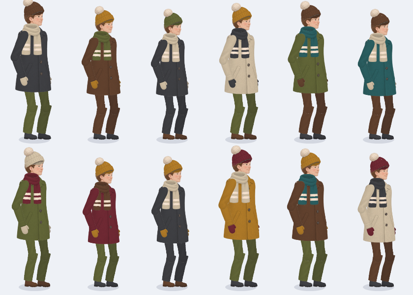
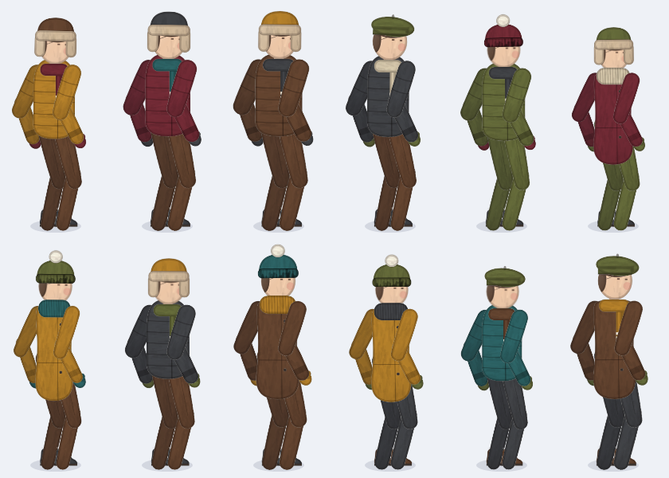
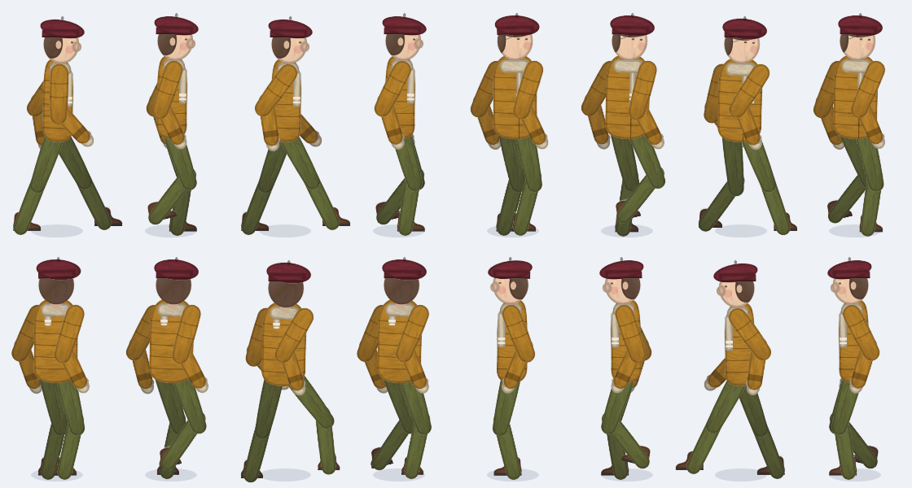
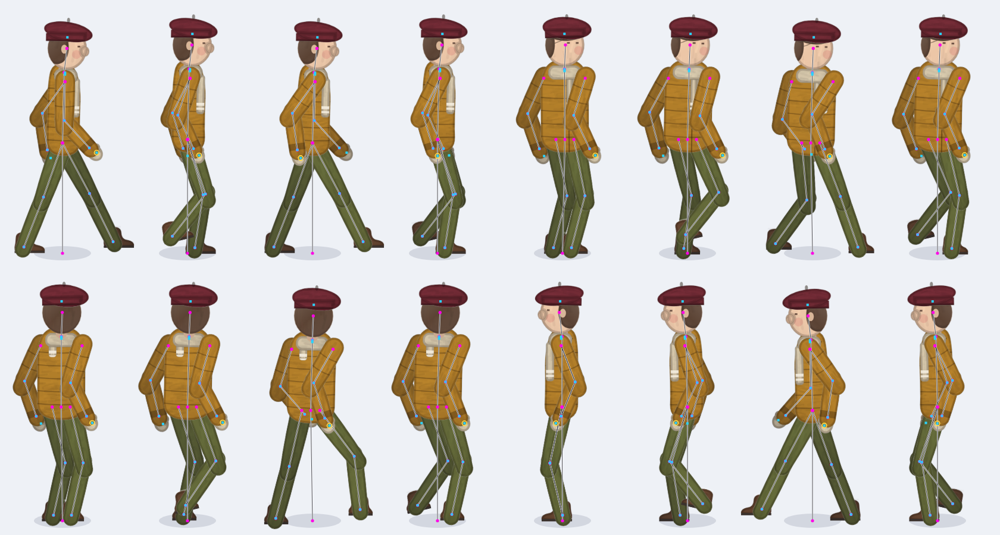

# Generátor malovaných postav

Generátor skládá postavy z **předem připravených malovaných dílů** na hierarchické 2D kostře.
Za běhu nic negeneruje AI – jen vybírá kompatibilní díly, barvy z připravených palet a omezené
parametry proporcí a pohybu.

> **Stav podkladů:**
> * **`painted-parts-cg`** – díly z ChatGPT (`grafika/zdroje/postava-dily-3q-zepredu-v1.webp`,
>   reference `postava-reference-v2.webp`), zpracované skriptem `scripts/process-character-parts.ts`.
>   Používá je demo „Náměstí s radnicí“ a generátor. Zatím jen **pohled šikmo zepředu**, jedna bunda,
>   kulich a šála (+ 7 palet). Ostatní pohledy mají explicitní náhradu šikmým pohledem zepředu.
> * **`painted-parts`** – DOČASNÉ procedurálně kreslené díly (3 pohledy, 2 bundy, 3 čepice, 2 šály),
>   ponechané jako technická ukázka a pro testy všech pravidel kombinování.



## Zpracování dodaného archu (`scripts/process-character-parts.ts`)

1. Originál zůstává beze změny v `grafika/zdroje/`.
2. Arch se rozdělí podle průhledných mezer; alfa se vyčistí (šum pozadí < 28 → 0, téměř plné → 255),
   ponechá se jen hlavní souvislá oblast dílu. Okraje byly čisté, bez světlého lemu.
3. Každý díl se změří (profil levého/pravého okraje po řádcích) a určí se klouby:
   rameno, loket, zápěstí, kyčel, koleno, kotník, krk, pánev, kotva čepice, kotva šály, úchop ruky.
4. Měřítko: délka dílu podle délky kosti šablony; šířka končetin sjednocena podle reference
   (nadloktí 8,6, předloktí 7,9, stehno 10,2, lýtko 9,4 j.). Kde se poměr stran lišil o víc než 12 %,
   je zapsán požadavek na přemalování (`artIssues`).
5. Úpravy: vnitřek čepice (tmavý průhled) odstraněn, otvor šály vyplněn stínem smyčky.
6. Maska přebarvení = šedá látka s nízkou sytostí; pleť, krémová bambule a proužky, knoflíky
   a podrážky se nepřebarvují. Kontrast textury v masce je snížen na polovinu, aby po obarvení
   nevznikaly bílé skvrny.

Zjištěné požadavky na úpravu grafiky (z `library.json` → `artIssues`):
* nadloktí a stehno jsou vůči délce příliš široké (šířka upravena ×0,66) – přemalovat užší a delší;
* průramky a límec trupu ukazují tmavý vnitřek (zakrytý rukávem, krkem a šálou) – lépe vyplnit látkou;
* chybí pohledy z boku, šikmo zezadu, zepředu a zezadu a další varianty oblečení.



## Architektura (navazuje na stávající systém)

| Vrstva | Soubor | Poznámka |
|---|---|---|
| Kinematika kostry | `src/core/anim/skeleton.ts` | **Jediná** implementace klidu, chůze a akcí – používá ji i původní testovací postava (`testFigure.ts`) |
| Datový model dílů | `src/core/anim/partLibrary.ts` | Knihovna (manifest dílů, šablony, skupiny, palety), vzhled postavy, validace |
| Generátor | `src/core/anim/appearanceGenerator.ts` | Jednotlivec, skupina, zámky, kompatibilita, počet kombinací |
| Sestavení a vykreslení | `src/core/render/rigRenderer.ts` | Díly → kosti, přebarvení přes masky, pořadí vrstev, úchopový bod |
| Napojení na scénu | `render/characterPose.ts` (`characterVisual`) | Stejná funkce pro simulaci (úchop hrnku), náhled i export |
| Ovládání postavy | `sim/context.ts` `CharacterControl` | směr, rychlost, animace, předmět v ruce, schopnosti |
| UI | `src/renderer/panels/CharacterGenerator.tsx` | panel **Postavy**, editor vzhledu, náhled, diagnostika |
| Diagnostika | `src/renderer/rigDiagnostics.ts` | kostra, klouby, kotvy, názvy dílů – jen editor |

Manifest postavy (`assets/characters/malovana-postava.json`) má `backend: "skeleton"` a
`rig: { library, bodyTemplate }`. Klipy, události (`take`, `sip`, `release`) a schopnosti jsou
stejné jako u testovací postavy, takže postava funguje v existujících trasách a činnostech
(káva) bez úprav jejich logiky. Vzhled o chování nerozhoduje.

## Kostra

```
kořen (země mezi chodidly)
└─ pánev ── kyčel L/R ── koleno ── kotník (bota)
   └─ trup ── krk ── hlava (čepice na kotvě „hat“)
      │      └─ šála na kotvě trupu „scarf“
      └─ rameno L/R ── loket ── zápěstí (rukavice, úchop „grip“)
```

* Díl se na kost jen posune a otočí, nikdy se libovolně nedeformuje.
* Proporce jsou koordinované: `height` násobí všechny kosti i díly stejně, `build` jen šířku
  trupu a končetin (napříč kostí). Rozsahy jsou v šabloně (`proportions`).
* Vzdálená končetina se kreslí za tělem a mírně ztmavená (`farShade`), blízká před ním;
  pořadí určuje `drawOrder` šablony pro každý pohled (`far.<slot>`, `near.<slot>`, `held`).

## Pohyb – kontaktně řízená chůze

Implementace podle zadání [`docs/zdroje/zadani-prirozene-chuze-2D.md`](zdroje/zadani-prirozene-chuze-2D.md)
(rešerše ChatGPT, zdroje [S1]–[S15]). Data: `src/core/anim/gaitData.json` (tabulky po 5 % cyklu pro
1,3 a 0,9 m/s), profil a interpolace `gaitProfile.ts`, kontakty `gaitKinematics.ts`, póza `skeleton.ts`.

* **Kontakty jsou závazné:** při došlapu se uloží světová kotva paty; opora je postupně pata →
  celá podrážka → přednoží (rocker tuhé boty). Kotník se dopočítá z kontaktu a natočení boty,
  kolena a kyčle IK. Opora se nikdy neposouvá – ani při změně rychlosti.
* **Švih** jde po tabulkové dráze kotníku; jen začátek a konec se plynule napojí na skutečné kontakty.
* **Dosah:** když opřená noha nedosáhne, nejdřív se víc zvedne pata kolem pevného přednoží, pak se
  případně mírně sníží pánev. Nic se nenatahuje.
* **Rychlost:** délka kroku `0,7·L·(v/v0)^0,45`, kadence z rychlosti; fáze `+= Δs / délka cyklu`;
  délka kroku a váha profilu (0,9 ↔ 1,3 m/s) se mění jen při došlapu; profily se míchají přes
  pojmenované události (došlap, celá podrážka, zvednutí paty, odraz), ne podle stejného procenta.
* **Pánev, trup, hlava, paže:** svislý pohyb z tabulky, boční posun, rotace a obliquita jako malé
  posuny kyčlí (ne rotace obrázku), předklon a jeho kmitání, protirotace hrudníku jako posuny ramen,
  absolutní stabilizace hlavy, rameno a loket z tabulky vůči stejnostranné noze.
* **Rozejití:** vpředu stojící noha zůstane opřená, zadní vykročí; první krok je kratší.
* **Zastavení:** opřená noha drží, pata/špička se položí, švihová noha dokročí malým obloukem.
* **Pohled** se mění jen při dvojí opoře (opřená bota neposkočí).
* **Individualita** (jednou na postavu, ze seedu): délka kroku 0,9–1,1, amplituda paží 0,65–1,35,
  zpoždění paže −2…+4 %, poměr levé/pravé paže 0,85–1,15, předklon −1…+2°, svislý pohyb pánve
  0,8–1,2, boční 0,75–1,25, rychlost 0,85–1,25.
* Geometrie boty (pata 3,3 j., přednoží 7,9 j. před kotníkem) je změřená z namalované boty.

### Ověření (tests/gait.test.ts, akceptační kritéria zadání)

| Kritérium | Požadavek | Běžná 1,3 m/s | Pomalá 0,9 m/s |
|---|---|---|---|
| Posun opory (postava 350 px) | < 0,25 px | 0,000 px | 0,000 px |
| Koleno ve švihu | 58–65° / 53–62° | 62,2° | 57,7° |
| Ohnutí kolena po došlapu | viditelné | ano | ano |
| Svislý rozsah pánve | 0,018–0,035 L | 0,0276 L | 0,0282 L |
| Kadence | 111,4 / 91 ±1 kroků/min | 111,4 | 91,0 |
| Délky kostí | odchylka < 0,1 % | splněno | splněno |
| Podlaha | průnik ≤ 0,001 L | splněno | splněno |
| Paže při došlapu stejnostranné nohy | vzadu | splněno | – |
| Změna rychlosti 0,9→1,3→0,9 m/s | bez posunu opory a skoku fáze | splněno | |
| Zastavení | opora drží, obě boty na zemi | splněno | |
| Rozejití | kratší první krok | splněno | |

### Ze zadání zatím neimplementováno

* plánování kroků v zatáčkách (natočení budoucích došlapů podle zakřivení, ostré otočky
  přešlapováním) – směr se zatím mění plynulým otáčením a pohled jen při dvojí opoře;
* zimní (opatrný) preset, rychlá chůze 1,7 m/s jako samostatný preset;
* drobné variace mezi kroky (±2,5 %), gesta hlavy v klidu (yaw vyžaduje podklady pohledů),
  krátké prolnutí při změně pohledu;
* příprava přenesením váhy před prvním krokem (0,2–0,4 s);
* testy při 24 a 60 fps (export je 30 fps; simulace má pevný krok 1/60 s, takže póza v daném čase
  na snímkové frekvenci nezávisí).



## Pohledy

Datový model zná `front`, `front3q` (šikmo zepředu), `side`, `back3q` (šikmo zezadu), `back`.
Dočasné díly existují pro `side`, `front3q`, `back3q`. Chybějící `front` a `back` mají explicitní
náhradu v šabloně (`viewFallbacks`: front→front3q, back→back3q); v náhledu jsou označené ✕
a diagnostika ve scéně ukazuje „náhrada za …“. Zadní pohled se nikdy nevytváří zrcadlením
předního. Zrcadlí se jen pro opačný směr (doleva) a jen díly s `mirrorSafe: true`.

## Formát knihovny dílů (`library.json`)

| Údaj dílu | Význam |
|---|---|
| `id` | stabilní identifikátor (`<varianta>.<slot>.<pohled>`) |
| `slot` | `head`, `torso`, `upperArm` (nadloktí), `forearm` (předloktí), `hand`, `thigh` (stehno), `shin` (lýtko), `foot` (bota), `hat`, `scarf` (doplňky) |
| `variantId` | vazba na jednotný vzhled napříč pohledy |
| `view` | pohled |
| `texture`, `mask` | ořezaný obrázek a maska přebarvitelné oblasti (stejný ořez) |
| `sourceSize`, `trim` | rozměr původního plátna a poloha ořezu v něm |
| `pivot` | bod otáčení = kloub, na který se díl připojuje (px **původního** plátna) |
| `anchors` | `end` (další kloub u končetin), `hat` (hlava), `scarf` (trup), `grip` (ruka) – px původního plátna |
| `boneDir` | směr kosti v obrázku: končetiny dolů (π/2), trup/hlava nahoru (−π/2), bota vpřed (0) |
| `layerOrder` | pořadí v rámci místa v `drawOrder` |
| `compatibleBodyTypes`, `compatibilityTags`, `paletteOptions`, `mirrorSafe` | pravidla kombinování |

Všechny souřadnice jsou vůči původnímu (neořezanému) plátnu; ořez průhledných okrajů polohu
nemění (renderer kreslí ořez na `trim.x, trim.y`). `pxPerUnit` převádí px na jednotky scény
(dočasné díly: 4 px/jednotku; postava 130 jednotek ≈ 520 px).

Varianty (`variants`) nesou pravidla: `tags`, `excludesTags` (např. nákrčník × vysoký límec bundy),
`requiresAnchors` (čepice vyžaduje kotvu hlavy `hat`, šála kotvu trupu `scarf`), `paletteOptions`.
Skupiny (`groups`) určují, které sloty jedna volba pokrývá (bunda = trup + obě nadloktí + obě
předloktí ⇒ rukávy vždy odpovídají bundě a mají stejnou barvu; jedna bota = pár).

## Uložená identita postavy

`characters[].appearance` v `project.json`:

```json
{ "generator": "parts", "libraryId": "malovane-docasne-v1", "seed": 123456, "bodyTemplate": "adult",
  "variants": { "jacket": "jacket_coat", "hat": "hat_beanie", "scarf": "scarf_long", "trousers": "trousers_basic",
                "boots": "boots_basic", "gloves": "gloves_basic", "head": "head_adult" },
  "colors": { "jacket": "petrolejova", "hat": "okrova", "scarf": "vinova", "gloves": "vinova", "trousers": "tmave-seda", "boots": "hneda" },
  "proportions": { "height": 1.02, "build": 0.97 },
  "motion": { "strideScale": 1.01, "armSwing": 0.93, "bob": 1.1, "sway": 0.9, "idleTempo": 1.04, "lean": 1.2, "speed": 0.97, "phase": 0.31 },
  "locks": ["jacket"] }
```

Ukládá se konkrétní výběr, ne jen seed ⇒ rozšíření knihovny dříve uložené postavy nezmění
(ověřeno testem). Seed slouží k reprodukci a k přegenerování.

## Pravidla barev

Palety: petrolejová, vínová, okrová, olivová, krémová, hnědá, tmavě šedá. Čepice i šála mají jinou
barvu než bunda (a navzájem, pokud to jde); rukavice ladí s čepicí nebo šálou; kalhoty a boty
z neutrálních možností. Přebarvuje se **jen oblast masky** násobením (zachová stínování); pleť,
vlasy, bambule, kožešina, knoflíky a podrážky se nepřebarvují. Ve skupině se nepoužije totožná
viditelná kombinace dvakrát a stejná barva bundy dvakrát po sobě; pokud je požadováno víc postav
než existuje kombinací, duplicity se povolí a panel to vypíše.

## Jak přidat bundu nebo čepici

1. Namalujte díly pro **všechny dostupné pohledy** šablony (`side`, `front3q`, `back3q`):
   bunda = `torso`, `upperArm`, `forearm`; čepice = `hat`.
2. Ke každému dílu dodejte masku přebarvitelné oblasti (bílá = přebarvit), nebo díl nepřebarvujte
   (`paletteOptions: []`).
3. Do `library.json` přidejte variantu (`group`, `label`, `tags`, `excludesTags`,
   `requiresAnchors`, `paletteOptions`) a díly (viz tabulka). Trup musí mít kotvy `neck` a `scarf`,
   rukávy kotvu `end` ve vzdálenosti délky kosti od pivotu (validace hlídá ±4 %).
4. Spusťte `npm test` – validace knihovny a testy kompatibility/mezer v kloubech.

## Jak doplnit další pohled

1. Do šablony přidejte `views.<pohled>` (promítnutý směr chůze `forward`, rozestup kyčlí/ramen),
   `drawOrder.<pohled>` a pohled do `availableViews`; odeberte jeho náhradu z `viewFallbacks`.
2. Dodejte díly **všech** variant pro tento pohled (jinak generátor variantu vyřadí jako
   nekompatibilní – tatáž postava musí existovat ve všech pohledech).
3. Mapování směru pohybu na pohled je v `viewForDirection` (`S` → `front`, `N` → `back`).

## Jak přidat tělesnou šablonu (dítě, senior…)

Přidejte položku do `bodyTemplates` (vlastní `bones`, `views`, `gait`, `idle`, `proportions`,
`motionRanges`, `drawOrder`) a díly s `compatibleBodyTypes` obsahujícím její `id`. Generátor
a renderer s více šablonami počítají (`bodyTemplate` je součástí vzhledu); UI volbu šablony
zatím nezobrazuje, protože existuje jen jedna.

## Požadavky na novou grafiku

* **Měřítko:** jednotné pro všechny díly (doporučeno 4 px na jednotku, tj. postava ~520 px
  vysoká bez čepice). Kosti šablony `adult`: stehno 31, lýtko 29, kotník nad zemí 3,
  pánev→krk 38, krk→střed hlavy 13, ramena 5 pod krkem, nadloktí 21, předloktí 20 jednotek.
* **Orientace:** končetiny svisle, kloub nahoře (pivot), další kloub dole (`end`); trup a hlava
  vzpřímeně s pivotem dole (pánev, krk); bota špičkou doprava (pohled z boku).
* **Překryv v kloubech:** stehno přesahuje nahoru do kabátu ≥ 5 jednotek a dolů přes koleno
  zaobleným koncem; lýtko a předloktí začínají ~1 jednotku nad kloubem (zakryje je díl nad nimi);
  nadloktí nesmí přečnívat nad linii ramen (začátek ≤ 1 jednotku nad ramenem); trup musí krýt
  horní konce stehen, šála/límec spodek krku. Test `v kloubech nevznikají mezery` to ověřuje.
* **Rukávy zvlášť:** trup bundy **bez rukávů** (rukávy jsou samostatné díly nadloktí/předloktí).
* **Okraje:** čistá průhlednost bez světlého lemu; PNG (ztrátová WebP dělá šum v alfě).
* **Barvy:** přebarvitelné plochy malovat ve světlé neutrální šedé se stínováním (násobí se barvou
  palety) + maska; ostatní (pleť, vlasy, doplňky) v konečné barvě.
* **Zrcadlení:** díl s nesouměrným detailem (např. konec šály jen na jedné straně) musí mít
  `mirrorSafe: false` a vlastní díl pro opačný směr.

## Příprava dodané grafiky (až dorazí prototyp)

Zadání popisuje, že trupy mají přimalované rukávy, i když jsou rukávy k dispozici i zvlášť. Postup:

1. Originál uložit beze změny do `grafika/zdroje/`.
2. Ověřit průhlednost a lem okrajů (jako u stánků – `scripts/process-graphics.ts`), rozdělit arch.
3. U trupů odstranit přimalované rukávy (ruční retuš – nelze automaticky bez poškození malby);
   pokud nepůjde čistě, použít dočasný trup a zapsat požadavek na opravu do `artIssues`.
4. Změřit měřítko a orientaci, sjednotit na `pxPerUnit`, doplnit pivoty a kotvy, masky barev.
5. Doplnit chybějící díly (např. zadní pohledy, lýtka, druhá strana šály) – do té doby jako
   označené dočasné díly.

## Ovládání v editoru

* Levý panel **Postavy**: počet, seed, palety, **Generovat**, náhledy skupiny, **Přegenerovat
  vybranou**, **Uložit výběr do projektu** (postavy dostanou počáteční body tras a automatickou
  kávu). Při nedostatku kombinací panel vypíše počet duplicit.
* Výběr postavy ve scéně → pravý panel **Vzhled**: bunda, čepice, šála (nekompatibilní volby jsou
  zakázané), barvy z povolených palet, zámky (díl, barva, proporce, pohyb), přegenerování,
  náhled klidu a chůze, přepínání skutečně dostupných pohledů, zrcadlení, kostra.
* Horní lišta **Kostra postav**: kostra, klouby (purpurové), kotvy (azurové), úchop (žlutý),
  u vybrané postavy názvy dílů a použitý pohled. Jen v editoru – export je bez nich (test).


